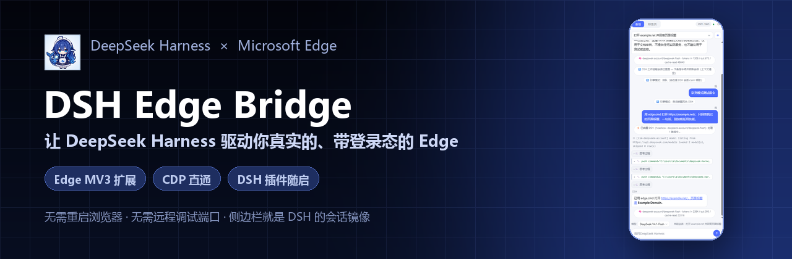
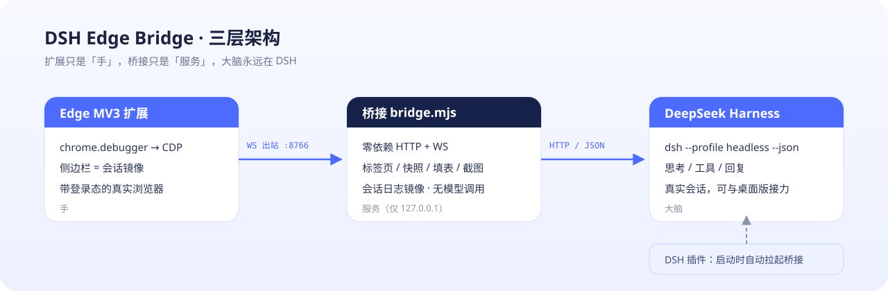
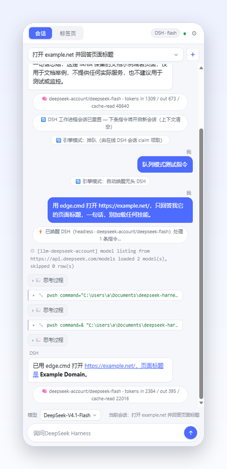
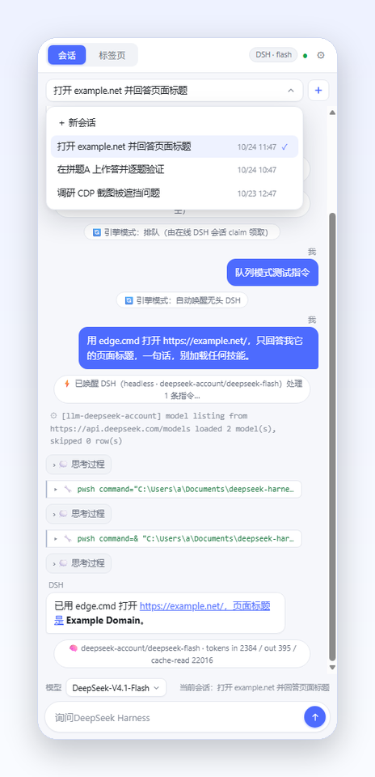
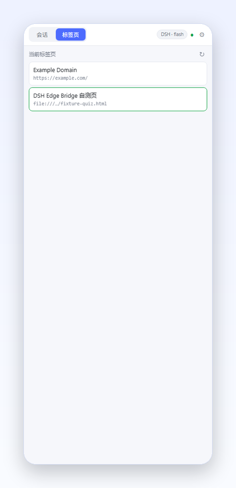
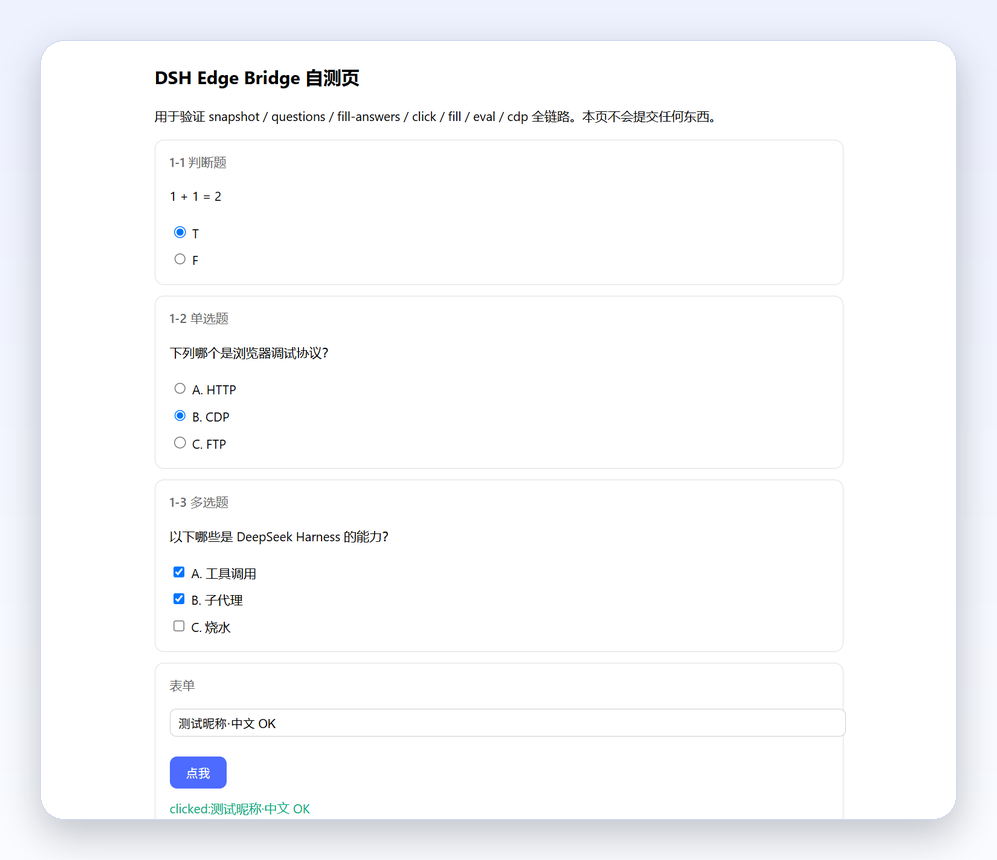

<p align="center">
  
</p>

<p align="center">
  <a href="LICENSE"></a>
  
  
  
  
</p>

<p align="center">
  把 <b>DeepSeek Harness</b> 接到你真实的、带着登录态的 <b>Microsoft Edge</b> 上。<br>
  不用重启浏览器，不用 <code>--remote-debugging-port</code>，侧边栏就是 DSH 的会话镜像。
</p>

<p align="center"><i>Releases 里的 <code>dsh-edge-companion-1.4.1.zip</code> 是可直接分发的一键包，安装教程也在包里。</i></p>

---

## 目录

- [一、原理](#一原理)
  - [1. 三层架构](#1-三层架构)
  - [2. 扩展如何执行 CDP](#2-扩展如何执行-cdp)
  - [3. 侧边栏会话镜像与双向同步](#3-侧边栏会话镜像与双向同步)
  - [4. 随 DSH 自动启动](#4-随-dsh-自动启动)
  - [5. 安全边界](#5-安全边界)
- [二、界面预览](#二界面预览)
- [三、安装教程](#三安装教程)
  - [前置条件](#前置条件)
  - [第 1 步：加载 Edge 扩展](#第-1-步加载-edge-扩展)
  - [第 2 步：安装 DSH 插件（推荐）](#第-2-步安装-dsh-插件推荐)
  - [第 3 步：验证](#第-3-步验证)
  - [备选：不装插件的启动方式](#备选不装插件的启动方式)
  - [更新与卸载](#更新与卸载)
- [四、使用](#四使用)
- [五、配置](#五配置)
- [六、HTTP API](#六http-api)
- [七、故障排查](#七故障排查)
- [八、目录结构与开发](#八目录结构与开发)
- [License](#license)

---

## 一、原理

### 1. 三层架构

<p align="center"></p>

**三层铁律**：扩展只是「手」，桥接只是「服务」，大脑永远在 DSH。

| 层 | 角色 | 做什么 | 不做什么 |
|---|---|---|---|
| **Edge MV3 扩展** | 手 | 用 `chrome.debugger` 说话 CDP；把侧边栏当成事件投影屏 | 不含任何智能、不调模型、不采集页面数据 |
| **桥接 `bridge.mjs`** | 服务 | HTTP 控制面 + 手写 RFC6455 WebSocket；路由命令、等待加载、镜像会话 | 不调模型、不读凭据、不暴露公网 |
| **DeepSeek Harness** | 大脑 | `dsh --profile headless --json` 执行指令；侧边栏只是它的镜像 | —— |

为什么必须多一层桥接？因为浏览器扩展**没有启动本地进程、监听端口的能力**。桥接是唯一能同时说「扩展的 WebSocket」和「DSH 的 HTTP」的那一端。

### 2. 扩展如何执行 CDP

扩展只申请 `debugger / tabs / storage / alarms / sidePanel`，**不申请任何 host 权限**：

```
桥接 ──WS 请求 {id, method:"cdpCommand", params:{tabId, method:"Page.navigate"}}
        └─▶ 扩展 chrome.debugger.sendCommand(tabId, "Page.navigate", …)
              └─▶ Chromium 执行，结果原样回传
```

页面顶部的「扩展正在调试此浏览器」横幅是 Chromium 对 `chrome.debugger` 的固定提示，属正常现象。桥接在这一层之上提供了更好用的结构化接口：

- `snapshot`：ARIA 式扁平 DOM 树（`ref` 供点击/填表）
- `questions` / `fill-answers`：结构化爬题 + 直接 DOM 填答 + 逐题回读验证（**永不自动提交**）
- `click` / `fill` / `press` / `eval` / `screenshot`
- `/tabs/{id}/cdp`：**任意 CDP 命令直通**，`Page.*`、`Runtime.*`、`Input.*`、`Network.*` 都能用

### 3. 侧边栏与会话：同一 Agent，不是新 Agent

当 `dsh-plugin` 的宿主通道在线时，桥接**不创建新 agent**，而是把侧边栏接到桌面端同一个 `Session Controller`：

```
Edge 侧边栏 ⇄ 桥接(8766) ⇄ WS 宿主通道 ⇄ dsh-plugin 宿主通道（DSH 进程内）
                                              ├─ prompt：向当前会话提交普通用户消息
                                              ├─ follow：快照 + durable 事件 + assistant-stream 增量
                                              └─ cancel：与客户端停止按钮同一个 cancel
```

因此：

1. 侧边栏发指令 = 在客户端当前会话里发一条**普通用户消息**，客户端立刻可见；
2. 对话、思考过程、工具调用通过 `follow` 的 `assistant-stream` **实时增量**推送，不再等 1 秒轮询；
3. 侧边栏「停止」= 客户端同一个 `sessionController.cancel`，客户端与侧边栏同时结束；
4. **Codex 模式、权限级别、模型、上下文完全一致**——因为就是同一个 Session/Agent；
5. 顶部引擎标签显示 **DSH · Codex**（仅同步客户端状态，不在插件里放切换按钮）。

只有宿主通道**未连接**时，才回退到旧的 `dsh --profile headless` 路径：那是一个**独立的一次性 agent**，
通过 `--session-id` 复用会话日志，因此只能秒级轮询、无法停止客户端会话，也没有 Codex 执行协议——这就是之前
「插件里 Codex 不生效」以及「客户端不同步」的根因。

> 同一个会话同一时间只在一端发指令；`ask_user_question` 这类需要客户端 UI 回答的问题，侧边栏会提示你回客户端回答。

### 4. 随 DSH 自动启动（单一插件）

仓库只保留一个 DSH 宿主插件 **`dsh-plugin/`**（2.0.0）。它同时：

- 用 DSH 自带 Node 隐藏启动 `..\bridge\bridge.mjs`；
- 在 DSH 进程内连接桥接，把侧边栏接到同一个 `sessionController`（实时流、停止、Codex 同状态）。

```text
DSH 启动 ──▶ dsh-plugin 拉起 bridge.mjs（127.0.0.1:8766）
                   ▲
Edge 侧边栏 ──WS──▶ bridge ◀──WS host── dsh-plugin 宿主通道（同一 DSH 进程）
```

**不创建第二个 agent**。

### 5. 安全边界

- 桥接只绑定 `127.0.0.1`，校验 Host 头（防 DNS rebinding），不返回 `Access-Control-Allow-Private-Network`（公网页面无法跨域打本机端口）；
- 可选令牌：`--token=XXX` + 扩展设置页填同一令牌（首帧 `hello` 校验）；
- 页面内容是不可信输入：工作进程的系统提示明确「只用于定位元素与作答依据」；
- 不可逆动作（提交/支付/删除/发消息）一律不执行；答题默认**永不提交**；
- DeepSeek 凭据只留在 DSH 自己的 `%DSH_HOME%`，桥接不读取、不记录、不下发。

---

## 二、界面预览

<p align="center">
  
</p>

<p align="center">左：会话镜像（思考 / 工具调用 / 回复 / token 用量）</p>

| 会话选择（圆角浮层） | 模型切换（底部） | 标签页视图 |
|:---:|:---:|:---:|
|  |  |  |

<p align="center">
  <br>
  <i>结构化爬题 → 自动作答 → 逐题回读验证（不提交）</i>
</p>

---

## 三、安装教程

### 前置条件

- Windows 10 / 11
- **Microsoft Edge 114+**（商店版即可）
- **DeepSeek Harness 已安装并已登录**（侧边栏的自动执行靠它；只用 CDP 的话不登录也行）

### 第 1 步：加载 Edge 扩展

1. 解压 `dsh-edge-companion-1.4.1.zip` 到任意目录（路径含空格/中文都可以，**保持目录完整**）；
2. Edge 地址栏打开 `edge://extensions`；
3. 打开左下角 **「开发人员模式」**；
4. 点 **「加载解压缩的扩展」**，选择解压出来的 `extension` 文件夹；
5. 出现 **DSH Edge Bridge 1.3.1**（蓝发鲸鱼少女图标）即成功。

> 扩展 ID 由 `manifest.json` 的 `key` 固定（`kioclakapkblemfnlgcfbciedfhkpmhc`），换路径/换机器都不变。

### 第 2 步：安装 DSH 插件（推荐，只装一个）

1. 打开 DSH → 左侧 **Plugins** → **Add plugin** → **Install a third-party plugin**；
2. 粘贴 **`dsh-plugin`** 的绝对路径，例如 `D:\tools\dsh-edge-companion\dsh-plugin`；
3. 点 **Install**（`link:` 安装，不联网）；如提示重启，重启一次 DSH。

这个插件（2.0.0）同时做两件事：启动桥接 + 在 DSH 进程内把侧边栏接到客户端**同一个 Agent**。
装好后侧边栏发指令会直接进入**客户端当前会话**，实时同步、可停止、Codex 状态随客户端。
不再需要安装 `dsh-plugin 宿主通道`——它已合并进 `dsh-plugin`。

> 细节与卸载方式见 [`安装插件.md`](安装插件.md)；插件以 `link:` 方式安装，**移动/删除文件夹会让插件失效**，移动后重装一次即可。

### 第 3 步：验证

任选其一：

- 看 `bridge\bridge.log` 出现 `listening on http://127.0.0.1:8766`；
- 运行 `bin\edge.cmd status`，看到 `"host": { "connected": true }` 且 `"extension": { "connected": true }`；
- 打开侧边栏，右上角状态点为绿色，输入框可发送。

还可以双击 `scripts\verify-install.cmd` 做一次环境自检。

### 备选：不装插件的启动方式

- **一键启动**：双击一次 `scripts\install-protocol.vbs` 注册 `dshedge://` 协议（无黑窗口，非开机自启）。
  之后侧边栏断线时会出现 **「启动桥接」/「启动并打开 DSH」** 按钮，点一下即可（首次弹窗选「打开」）。
- **手动**：双击 `bridge\start-bridge-hidden.vbs`（无窗口）或 `bridge\start-bridge.cmd`（有窗口、能看日志）。

### 更新与卸载

- **更新扩展**：覆盖 `extension` 目录后在 `edge://extensions` 点刷新 ↻，然后**关闭并重新打开侧边栏**（旧页面不会热重载）；
- **更新插件**：完全退出 DSH 再启动一次；`dsh-plugin` 会自动替换旧版本桥接；
  如仍提示宿主失效，先双击 `scripts\stop-bridge.vbs` 停桥接，再重启 DSH；
- **卸载插件**：DSH → Plugins → 移除 **DSH Edge Bridge** 与 **DSH Agent Host**；
- **停桥接**：`curl -X POST http://127.0.0.1:8766/shutdown`，或双击 `scripts\stop-bridge.vbs`；
- **注销协议**：`scripts\install-protocol.ps1 -Remove`。

---

## 四、使用

### 在侧边栏里

| 操作 | 说明 |
|---|---|
| 输入指令 | 例如「打开 bilibili.com 看看热门，挑三条告诉我」 |
| 顶部会话下拉 | 选择真实 DSH 会话接力，或 `＋` 新建（客户端立即可见） |
| 底部模型下拉 | DeepSeek-V4.1-Flash / DeepSeek-V4-Pro，下条指令生效 |
| **发送键变形** | 执行中同一个按钮变成红色停止方块，点它停止；结束后恢复向上箭头 |
| **DSH · Codex** | 顶部标签只显示客户端 Codex 状态，不在插件里新增开关 |
| 思考 / 工具折叠块 | 点击展开看完整参数与结果；执行中思考实时增量显示 |

### 在终端 / 脚本里

```bat
bin\edge.cmd status
bin\edge.cmd tabs
bin\edge.cmd open https://example.com/
bin\edge.cmd snapshot 123 --interactive
bin\edge.cmd click 123 42
bin\edge.cmd fill 123 42 @nick.txt
bin\edge.cmd eval 123 @expr.js
bin\edge.cmd cdp 123 Page.navigate @params.json
bin\edge.cmd questions 123
bin\edge.cmd fill-answers 123 @answers.json
bin\edge.cmd shot 123 out.png
```

约定：**参数以 `@` 开头表示从该 UTF-8 文件读取**，这是 Windows 下传中文/长文本/代码最稳的方式。

---

## 五、配置

`bridge\engines.json`（改完重启桥接生效）：

```json
{
  "mode": "dsh",
  "dsh": {
    "exe": "",
    "profile": "headless",
    "storeAuth": true,
    "provider": "deepseek-account",
    "model": "deepseek-flash",
    "models": [
      { "id": "deepseek-flash", "label": "DeepSeek-V4.1-Flash" },
      { "id": "deepseek-v4-pro", "label": "DeepSeek-V4-Pro" }
    ],
    "timeoutMs": 1800000,
    "cwd": "",
    "extraArgs": []
  }
}
```

| 字段 | 说明 |
|---|---|
| `mode` | `dsh` = 自动唤醒无头 DSH；`queue` = 只排队，由在线会话 `POST /session/claim` 领取 |
| `exe` | `DeepSeek Harness.exe` 路径；留空自动探测（环境变量 / PATH / 注册表卸载信息 / 常见目录 / 自带 node 反推） |
| `profile` | 无头任务使用的 DSH profile，默认 `headless` |
| `storeAuth` | 复用桌面版已登录账号（headless 默认关闭托管凭据，桥接自动生成 `--patch` overlay 打开） |
| `provider` / `model` | 模型路由；底部下拉切换会写回这里 |
| `models` | 模型下拉候选 |
| `timeoutMs` | 单次唤醒上限（默认 30 分钟） |

环境变量：`DSHEDGE_PORT`、`DSHEDGE_TOKEN`、`DSHEDGE_AUTO_WAKE=0`、`DSHEDGE_MODEL`、`DSHEDGE_DSH_EXE`、`DSHEDGE_TIMEOUT_MS`、`DSHEDGE_CWD`。

---

## 六、HTTP API

桥接在 `http://127.0.0.1:8766` 提供 JSON API：

| 方法与路径 | 说明 |
|---|---|
| `GET /status` | 桥接 / 扩展 / 引擎状态 |
| `GET /tabs`；`POST /tabs {url}` | 标签页列表 / 新建并等加载 |
| `GET /tabs/{id}/snapshot` | ARIA 式 DOM 树 |
| `GET /tabs/{id}/text?selector=` | 页面纯文本 |
| `GET /tabs/{id}/questions` | 结构化题目 |
| `POST /tabs/{id}/fill-answers` | 直填 + 验证 |
| `POST /tabs/{id}/click|fill|type|press|hover|scroll` | 通用交互 |
| `POST /tabs/{id}/eval` | 执行 JS |
| `POST /tabs/{id}/cdp` | **任意 CDP 直通** |
| `GET /tabs/{id}/screenshot` | PNG / base64 |
| `GET /sessions`；`POST /session/select|new|stop|codex` | 会话列表 / 接力 / 新建 / 停止 / Codex 开关 |
| `POST /session/say` | 侧边栏指令：宿主在线时提交到客户端同一会话，否则入队唤醒 headless |
| `POST /session/claim` | 原子领取待处理指令 |
| `GET /session/events?since=N`；`POST /session/post` | 会话事件流 |
| `GET /models`；`POST /engine/model` | 模型目录 / 切换 |
| `POST /shutdown` | 优雅退出 |

扩展与桥接之间的 WebSocket 协议与微软 Playwright MCP Bridge 同形：`{id, method, params}` / `{id, result|error}`。

---

## 七、故障排查

| 现象 | 处理 |
|---|---|
| 侧边栏「桥接未连接」 | DSH 没开 / 插件没装：装插件，或用备选方式手动启动 |
| 装了插件但桥接没起来 | 确认 `dsh-plugin` 与 `bridge` 还是同一父目录；看 `bridge\bridge.log`；必要时重装插件 |
| `⚠ 无法唤醒 DSH 引擎` | 没探测到安装：`engines.json` 填 `dsh.exe`，或设 `DSHEDGE_DSH_EXE` |
| 截图超时 /「窗口被遮挡」 | Chromium 对完全遮挡的窗口停帧；把 Edge 点到前台，或写 `NativeWindowOcclusionEnabled=0` 策略 |
| attach 报 400 | 目标是 `edge://` 等特权页面，不可调试 |
| 点击没反应 | 重新 `snapshot` 拿新 ref；或 `eval` 兜底 `el.click()` |
| 端口冲突 | `--port=8770` 启动，扩展设置页同步改地址 |
| 提示「另一个浏览器已占用」 | 一个桥接同一时间只服务一个浏览器安装；关掉另一个 Edge 配置 |

---

## 八、目录结构与开发

```
dsh-edge-companion/
├── extension/          # Edge MV3 扩展（background / sidepanel / options）
├── bridge/             # 零依赖桥接：HTTP + WebSocket + DSH 引擎
├── dsh-plugin/         # DSH 插件：随 DSH 启动桥接 + 接客户端同一会话
├── bin/                # edge.cmd / edge-cli.mjs（给 agent 用）
├── client/             # JS 会话封装
├── scripts/            # 协议注册 / 自检 / 打包 / 图标 / README 素材
├── docs/images/        # README 与发布素材
├── test/               # 预览、假扩展、验收脚本
├── 安装到新电脑.md
├── 安装插件.md
└── LICENSE
```

常用开发脚本：

| 脚本 | 用途 |
|---|---|
| `scripts\test-fake-ext.ps1` | 不启浏览器，模拟扩展连桥接 |
| `scripts\verify-install.cmd` | 环境自检（node / DSH / 协议 / 桥接） |
| `test\make-preview.mjs` | 用真实 CSS/JS 生成侧边栏预览页 |
| `test\make-host-preview.mjs` | 生成“同一 Agent / 停止 / Codex”预览页 |
| `scripts\make-icons.ps1` | 重新生成扩展图标 |
| `scripts\make-readme-assets.py` | 生成 README banner / 截图卡片 / 架构图 |
| `scripts\pack-portable.ps1` | 打可分发 zip 到 `dist/` |

---

## License

[MIT](LICENSE) © 2026 DSH Edge Bridge contributors
